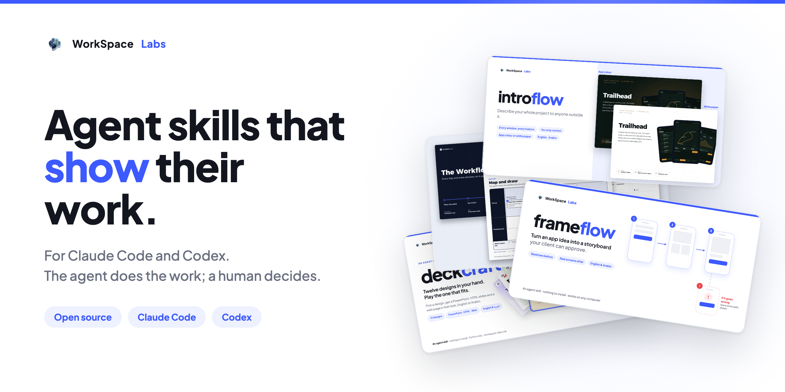

<!-- Generated by scripts/build_readme.py. Edit profile.json or the script, not this file. -->

<a href="https://workspace-labs.net"><strong>Website ↗</strong></a> &nbsp;·&nbsp;
<a href="https://www.linkedin.com/in/workspacelabs"><strong>LinkedIn</strong></a> &nbsp;·&nbsp;
<a href="https://x.com/workspacelabs91"><strong>X</strong></a>

## ✨ Newest

<table>
<tr>
<td width="55%"></td>
<td valign="middle">
<code>0.3.0</code> &nbsp;🆕
<h3><a href="https://github.com/workspace-labs/project-journey">project-journey</a></h3>

Which skill first, and which comes next.

<a href="https://github.com/workspace-labs/project-journey#install"><strong>Install →</strong></a>

</td>
</tr>
</table>

## 📄 Documents your project needs

<table>
<tr>
<td width="33%" valign="top">
 
<h3><a href="https://github.com/workspace-labs/introflow">introflow</a></h3>

Describe your whole project to anyone outside it.

<a href="https://github.com/workspace-labs/introflow#install"><strong>Install →</strong></a>

</td>
<td width="33%" valign="top">
 
<h3><a href="https://github.com/workspace-labs/workflow-project">workflow-project</a></h3>

Understand a new project first, then hand over how it works from A to Z.

<a href="https://github.com/workspace-labs/workflow-project#install"><strong>Install →</strong></a>

</td>
<td width="33%" valign="top">
 
<h3><a href="https://github.com/workspace-labs/project-docs">project-docs</a></h3>

The documents your project needs, written with you before anyone builds it.

<a href="https://github.com/workspace-labs/project-docs#install"><strong>Install →</strong></a>

</td>
</tr>
<tr>
<td width="33%" valign="top">
 
<h3><a href="https://github.com/workspace-labs/frameflow">frameflow</a></h3>

Turn an app idea into a storyboard your client can approve.

<a href="https://github.com/workspace-labs/frameflow#install"><strong>Install →</strong></a>

</td>
<td width="33%" valign="top">
 
<h3><a href="https://github.com/workspace-labs/deckcraft">deckcraft</a></h3>

Decks and web pages with real design.

<a href="https://github.com/workspace-labs/deckcraft#install"><strong>Install →</strong></a>

</td>
<td width="33%" valign="top">
 
<h3><a href="https://github.com/workspace-labs/week-planner">week-planner</a></h3>

Plan Sunday, review Saturday.

<a href="https://github.com/workspace-labs/week-planner#install"><strong>Install →</strong></a>

</td>
</tr>
</table>

## 🧑‍✈️ Agent discipline

<table>
<tr>
<td width="33%" valign="top">
 
<h3><a href="https://github.com/workspace-labs/software-engineering-build-standard">software-engineering-build-standard</a></h3>

An engineering standard for AI agents that build software.

<a href="https://github.com/workspace-labs/software-engineering-build-standard"><strong>Install →</strong></a>

</td>
<td width="33%" valign="top">
 
<h3><a href="https://github.com/workspace-labs/ultracode-discipline">ultracode-discipline</a></h3>

Disciplined multi-agent execution for Claude UltraCode.

<a href="https://github.com/workspace-labs/ultracode-discipline#install"><strong>Install →</strong></a>

</td>
<td width="33%" valign="top">
 
<h3><a href="https://github.com/workspace-labs/agent-health-checks">agent-health-checks</a></h3>

Two read-only checkers for AI agents.

<a href="https://github.com/workspace-labs/agent-health-checks#install"><strong>Install →</strong></a>

</td>
</tr>
<tr>
<td width="33%" valign="top">
 
<h3><a href="https://github.com/workspace-labs/agent-builder-handoff">agent-builder-handoff</a></h3>

A builder handoff for AI agents.

<a href="https://github.com/workspace-labs/agent-builder-handoff"><strong>Install →</strong></a>

</td>
</tr>
</table>

## ✋ Human gate

<table>
<tr>
<td width="33%" valign="top">

<h3><a href="https://github.com/workspace-labs/human-handoff">human-handoff</a></h3>

A human handoff for AI agents.

<a href="https://github.com/workspace-labs/human-handoff"><strong>Install →</strong></a>

</td>
<td width="33%" valign="top">

<h3><a href="https://github.com/workspace-labs/vibe-to-engineering">vibe-to-engineering</a></h3>

Checks from evidence whether a project needs restructuring and, if it does, migrates it one approved phase at a time with verified recovery checkpoints.

<a href="https://github.com/workspace-labs/vibe-to-engineering#install"><strong>Install →</strong></a>

</td>
</tr>
</table>

## 🧩 More

<table>
<tr>
<td width="33%" valign="top">
 
<h3><a href="https://github.com/workspace-labs/weekflow">weekflow</a></h3>

A skill for running weekly client meetings from the project's real work.

<a href="https://github.com/workspace-labs/weekflow#install"><strong>Install →</strong></a>

</td>
<td width="33%" valign="top">
 
<h3><a href="https://github.com/workspace-labs/checkflow">checkflow</a></h3>

A skill for checking a finished project against what the client approved, before handover.

<a href="https://github.com/workspace-labs/checkflow#install"><strong>Install →</strong></a>

</td>
<td width="33%" valign="top">
 
<h3><a href="https://github.com/workspace-labs/agent-review-handoff">agent-review-handoff</a></h3>

An independent review handoff for AI agents.

<a href="https://github.com/workspace-labs/agent-review-handoff"><strong>Install →</strong></a>

</td>
</tr>
<tr>
<td width="33%" valign="top">
 
<h3><a href="https://github.com/workspace-labs/break-it">break-it</a></h3>

Agent skill: the reviewer attacks a throwaway local copy of your own app and reports every hole before you ship.

<a href="https://github.com/workspace-labs/break-it"><strong>Install →</strong></a>

</td>
</tr>
</table>

<a href="https://github.com/workspace-labs?tab=repositories"><strong>All repositories →</strong></a>

